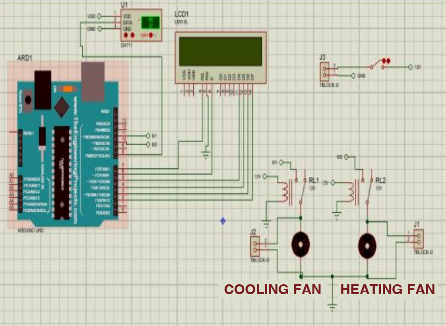
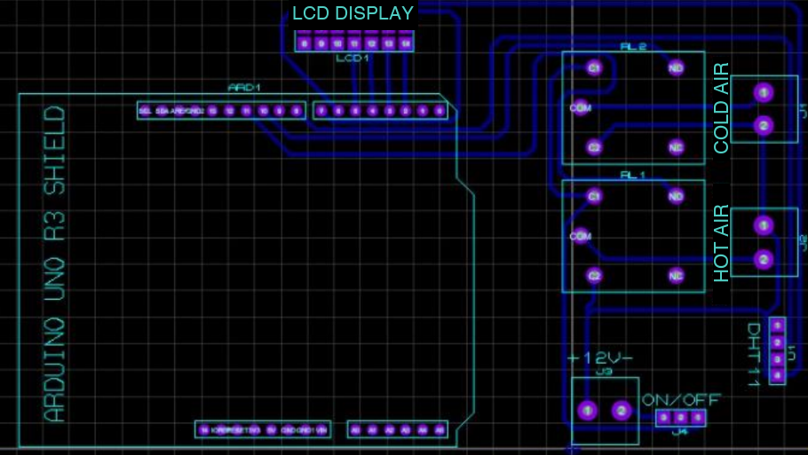

# Smart Incubator

Arduino firmware for a temperature-controlled incubator. A **DHT11** sensor measures
temperature and humidity, a **16x2 LCD** shows them, and two **relays** switch a heating fan
and a cooling fan to keep the temperature inside a configurable band.

**Version 1.0.0** · [Changelog](CHANGELOG.md) · [MIT License](#license)

```
DHT11  →  Thermostat (band + hysteresis)  →  Heater relay / Cooler relay
                 └──────────────────────→  LCD and serial log
```



---

## Contents

- [What you get](#what-you-get)
- [Hardware](#hardware)
- [Wiring](#wiring)
- [Build and upload](#build-and-upload)
- [Configuration reference](#configuration-reference)
- [How it works](#how-it-works)
- [Display and serial output](#display-and-serial-output)
- [Testing](#testing)
- [Troubleshooting](#troubleshooting)
- [Project layout](#project-layout)
- [License](#license)

---

## What you get

| | |
|---|---|
| **Closed-loop temperature control** | Heater below the lower limit, cooler at or above the upper limit, both off in between |
| **Hysteresis** | A relay stays on until the temperature is half a degree inside the band, so it does not chatter at a threshold |
| **Fail-safe** | A failed sensor read switches both relays off and shows `Sensor error` |
| **Non-blocking** | The loop is timed with `millis()`, not `delay()` |
| **One config file** | Pins, limits, relay polarity and timing live in [`config.h`](firmware/smart_incubator/config.h) |
| **Tested logic** | The control logic has no Arduino dependency and is unit-tested on a PC and in CI |
| **Serial log** | CSV lines (`temperature_c,humidity_pct,state`) for logging or plotting |

---

## Hardware

| Part | Notes |
|---|---|
| Arduino Uno (or compatible AVR board) | Other boards work if the pins in `config.h` are adjusted |
| DHT11 temperature and humidity sensor | 0–50 °C at ±2 °C, 20–80 % RH at ±5 % — coarse, see [Troubleshooting](#troubleshooting) |
| 16x2 character LCD with I2C backpack | PCF8574, address `0x27` by default |
| Two relay channels | Active-low relay module (switches on when the input is LOW) |
| Heating fan and cooling fan, 12 V supply | Switched through the relay contacts |

Do not drive a bare relay coil from an Arduino pin: a pin supplies about 20 mA. Use a relay
module with its own driver, or a transistor and a flyback diode.

---

## Wiring

| Signal | Arduino pin |
|---|---|
| DHT11 data | `D2` |
| Heater relay input | `D10` |
| Cooler relay input | `D11` |
| LCD SDA / SCL | `A4` / `A5` |
| Power | `5V` and `GND` for the sensor, LCD and relay module |



The images in `docs/images/` are the original Proteus schematic and shield layout. They show
the LCD in parallel mode (an LM016L), while this firmware drives it over I2C; use either the I2C
backpack or change the display code. The relay-to-fan assignment on the board may also differ from
the firmware's, so check the output on the bench before connecting a load.

---

## Build and upload

With [`arduino-cli`](https://arduino.github.io/arduino-cli/):

```bash
make libs                          # AVR core and the three libraries, once
make compile                       # build for an Arduino Uno
make upload PORT=/dev/ttyACM0      # flash it
make monitor PORT=/dev/ttyACM0     # serial output at 9600 baud
```

Another board: `make compile FQBN=arduino:avr:nano`.

With the Arduino IDE: open `firmware/smart_incubator/smart_incubator.ino`, install
*DHT sensor library*, *Adafruit Unified Sensor* and *LiquidCrystal I2C* from the Library
Manager, and upload.

---

## Configuration reference

Everything is in [`firmware/smart_incubator/config.h`](firmware/smart_incubator/config.h).

| Constant | Default | Meaning |
|---|---|---|
| `PIN_DHT` | `2` | DHT11 data pin |
| `PIN_HEATER_RELAY` | `10` | Heater relay input |
| `PIN_COOLER_RELAY` | `11` | Cooler relay input |
| `RELAY_ACTIVE_LOW` | `true` | `true` if the relay switches on when its input is LOW |
| `LCD_ADDRESS` | `0x27` | I2C address (often `0x3F` on other backpacks) |
| `LCD_COLUMNS`, `LCD_ROWS` | `16`, `2` | Display size |
| `HEAT_BELOW_C` | `36.0` | Start heating below this temperature |
| `COOL_AT_OR_ABOVE_C` | `39.0` | Start cooling at or above this temperature |
| `HYSTERESIS_C` | `0.5` | Distance inside the band at which a running relay switches off |
| `SAMPLE_INTERVAL_MS` | `2000` | Time between readings (the DHT11 allows at most one per second) |
| `SERIAL_BAUD` | `9600` | Serial speed |

The limits are those of the original program. Set them for what you are incubating.

---

## How it works

The controller has four states and re-evaluates them on every reading:

| State | Entered when | Heater | Cooler |
|---|---|---|---|
| `Idle` | temperature is inside the band | off | off |
| `Heating` | below `HEAT_BELOW_C`; leaves at `HEAT_BELOW_C + HYSTERESIS_C` | **on** | off |
| `Cooling` | at or above `COOL_AT_OR_ABOVE_C`; leaves at `COOL_AT_OR_ABOVE_C − HYSTERESIS_C` | off | **on** |
| `Fault` | the sensor returned no valid reading | off | off |

The heater and cooler are never on together. At power-up both relay pins are set to their off
level before they become outputs, so the relays do not pulse.

The logic lives in [`thermostat.h`](firmware/smart_incubator/thermostat.h); the sketch only reads
the sensor, applies the result to the relays and updates the display.

---

## Display and serial output

```
T: 37.5C H: 55%
Idle
```

The second line shows `Idle`, `Heating`, `Cooling` or `Sensor error`. The serial port prints
one CSV line per reading:

```
temperature_c,humidity_pct,state
37.0,55,Idle
35.0,56,Heating
0.0,0,Sensor error
```

On an error line the numbers are placeholders.

---

## Testing

```bash
make test
```

builds `test/test_thermostat.cpp` with `g++` and checks the band boundaries, both hysteresis
directions, a direct swing from heating to cooling, recovery after a sensor fault, and that the
two outputs are never on together. No Arduino is needed. CI runs the same tests and compiles the
sketch for an Arduino Uno on every push. The firmware has been compiled and its logic tested,
but it has not been run against real hardware by the maintainers of this rewrite: check the relay
polarity and the LCD address on the bench first.

---

## Troubleshooting

| Symptom | Cause and fix |
|---|---|
| Display stays dark | Adjust the contrast trimmer on the backpack, and check that `LCD_ADDRESS` matches (`0x27` or `0x3F`) |
| Display shows blocks | The LCD initialised but got no text: check SDA/SCL (`A4`/`A5`) |
| `Sensor error` all the time | DHT11 data not on `D2`, no 5 V, or a missing pull-up on a bare sensor (modules have one) |
| Both relays seem inverted | The relay board is active-high: set `RELAY_ACTIVE_LOW` to `false` |
| A relay clicks at power-up | Its input is floating before `setup()`; add a 10 kΩ pull-up to the input |
| Temperature jumps by whole degrees | The DHT11 resolves 1 °C. For finer control use a DHT22 (`DHT dht(PIN_DHT, DHT22)`) |
| `dht11.h: No such file` | That header belongs to an older library. This project uses the Adafruit *DHT sensor library* |
| Compile error about `LiquidCrystal_I2C.h` | Install *LiquidCrystal I2C* (Frank de Brabander) from the Library Manager |

---

## Project layout

```
firmware/smart_incubator/
    smart_incubator.ino   sensor, relays, display, serial
    thermostat.h          control logic (no Arduino dependency)
    config.h              pins, limits, timing
test/test_thermostat.cpp  host-side unit tests
docs/images/              schematic.png  pcb.png
Makefile  .github/workflows/ci.yml
```

---

## License

Released under the [MIT License](LICENSE). Copyright 2024 Berkay Ahmet Durmuş.
